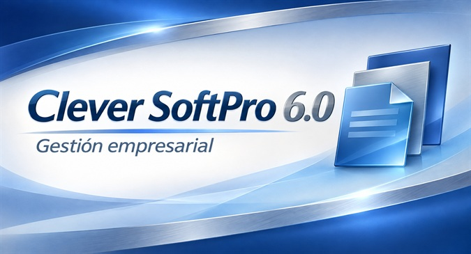
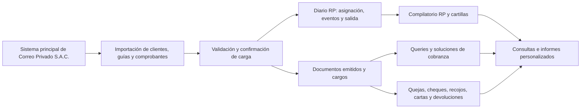

# Clever SoftPro 6.0 · TNT

**Gestión de cobranzas y seguimiento de servicios courier de importación.**

Concebido y programado en **2011** por **Juan Pablo Aguilar Campos** para **Correo Privado S.A.C., nombre comercial TNT**, para resolver necesidades de trabajo que el sistema principal de la empresa no cubría. La aplicación era utilizada por las áreas de **Cobranzas, Operaciones, Importaciones y Facturación**.

Clever SoftPro trabajaba con la información del sistema principal. Las importaciones permitían incorporar sus clientes, guías y comprobantes para organizar la gestión diaria, relacionar los servicios facturados y dar seguimiento a las incidencias entre las distintas áreas.

[Instalación de la base de datos](BaseDatos/LEEME.md) · [Recorrido de demostración](BaseDatos/Demo.md) · [Formatos de importación](Ejemplos/LEEME.md)

<p align="center">
  
</p>

## Origen y concepto

La información necesaria para gestionar los servicios ya existía en el sistema de Correo Privado S.A.C., pero algunas tareas de seguimiento y coordinación requerían un tratamiento adicional. Clever SoftPro nació para atender ese trabajo: reunir los documentos relacionados, mantener una pizarra de gestión de guías, registrar incidencias de cobranza y consultar cómo se había resuelto cada expediente.

Esa dependencia de los datos del sistema principal explica el papel central de la importación. Clientes, facturas, boletas, notas de crédito, notas de débito y servicios facturados se incorporan a una base propia, donde se conserva su relación con las guías y con los eventos de gestión. El sistema emisor mantiene el control de sus comprobantes y saldos.

Este repositorio conserva como proyecto de portafolio la aplicación desarrollada en 2011, con su entorno original de escritorio Visual Basic 6.0. Incluye los fuentes, el esquema SQL completo, datos ficticios y formatos Excel para construir y recorrer una instalación nueva. La demostración corresponde al alcance de importaciones descrito a continuación.

## El problema que resuelve

Una guía representa un servicio que debe poder seguirse desde su ingreso hasta su gestión y su relación con los documentos facturados. Cobranzas necesita identificar lo pendiente, registrar una observación o solicitar una corrección; Operaciones e Importaciones necesitan conocer la situación de la guía; Facturación necesita disponer de la relación de servicios y de las incidencias que requieren atención.

Clever SoftPro reúne ese seguimiento mediante Diario RP, Compilatorio RP, documentos y cargos, Queries y expedientes de cobranza. Cada gestión conserva sus relaciones e historial para consultar qué ocurrió y continuar el trabajo.

En el alcance de esta demostración, las guías son de importación y admiten gestión **RP — Receiver Pay, el que recibe paga — o Sender**. Los productos son **15D** para documentos y **15N/48N** para muestras. Diario y Compilatorio reciben la información de la carga central de guías.

Los clientes procedentes del sistema principal se actualizan mediante importación. Los clientes creados localmente disponen de una serie propia, `CS`, y admiten mantenimiento manual. Esta distinción permite reconocer el origen de cada registro y conservar las referencias de los documentos importados.

## Flujo de trabajo



El servicio facturado vincula un comprobante con su guía. Las cartillas y los grupos de clientes apoyan la organización del trabajo RP; los cargos permiten controlar la distribución de documentos. Queries registra solicitudes y soluciones de gestión, incluidas notas de crédito y documentos de reemplazo recibidos del sistema emisor.

## Funciones

| Área | Trabajo que permite realizar |
| --- | --- |
| Clientes | Consultar clientes locales e importados, crear locales con serie propia y gestionar bajas conservando sus relaciones. |
| Importación | Validar y confirmar libros Excel de clientes, guías, facturas, boletas, notas de crédito/débito y servicios facturados. |
| Diario RP | Asignar cliente e importes, registrar eventos, controlar la salida, agrupar clientes y preparar cartillas para facturación externa. |
| Compilatorio RP | Consultar gestiones confirmadas o finalizadas, reimprimir cartillas y reactivar expedientes conservando su historial. |
| Documentos y cargos | Consultar comprobantes y sus guías, organizar documentos en ocho bandas, registrar cargos, anularlos, reactivarlos y reimprimirlos. |
| Queries | Registrar solicitudes de corrección, consultar expedientes y registrar soluciones con notas de crédito o documentos de reemplazo. |
| Quejas | Registrar casos y gestiones por cliente, con su cierre e historial. |
| Cheques rechazados | Registrar el cheque, sus gastos y carta; finalizar o anular la gestión. |
| Recojos | Preparar órdenes de recojo de cheques o facturas, con destinatarios y mensajes. |
| Cartas | Preparar primera y segunda emisión, asociar documentos, consultar el historial, reimprimir y preparar avisos de correo. |
| Devoluciones | Gestionar expedientes con documentos y guías o destinatario manual, emitir carta y registrar cierre o anulación. |
| Informes | Elegir origen, columnas y hasta cuatro filtros Y/O; exportar a Excel o texto e imprimir resultados. |
| Configuración | Mantener catálogos, usuarios, perfiles y permisos por módulo. |

La ayuda de la aplicación incluye una guía breve de uso y la información de autoría en «Acerca de».

## Tecnología

- **Visual Basic 6.0**: aplicación de escritorio con formularios MDI.
- **SQL Server 2008**: tablas, claves, relaciones, índices, vistas y procedimientos almacenados; nivel de compatibilidad 100.
- **ADO y SQLOLEDB**: acceso a datos y operaciones transaccionales.
- **Controles OCX**: MSComctl, MSFlexGrid y HookMenu.
- **Data Report de VB6** e impresión nativa.
- **Microsoft Excel** mediante automatización COM para importar y exportar.
- **MD5** para las claves de acceso según el contrato de la aplicación.

Los componentes de terceros y sus licencias se obtienen por separado. Las referencias del proyecto pueden requerir ajuste al registrar los componentes COM de 32 bits en otro equipo. Los avisos de sus autores se conservan en los fuentes correspondientes.

## Construir y probar la demostración

Se necesita SQL Server 2008 en **localhost\SQLEXPRESS**, autenticación Windows, Visual Basic 6.0, los componentes COM registrados y Excel.

Desde PowerShell, en la raíz del repositorio:

```powershell
& .\BaseDatos\Instalar.ps1 -Base CleverSoftPro6 -DatosDemo
& .\Compilar.ps1
& .\bin\Clever.exe
```

El instalador crea una base nueva y no sobrescribe bases ni archivos existentes. [Esquema.sql](BaseDatos/Esquema.sql) contiene el DDL final; [DatosDemo.sql](BaseDatos/DatosDemo.sql), los catálogos y expedientes ficticios relacionados de todos los módulos. La instalación es independiente de respaldos o bases del entorno de desarrollo.

**Acceso demo:** `DEMO` / `123456` (administrador) y `OPER` / `123456` (perfil Operaciones). El [recorrido de demostración](BaseDatos/Demo.md) identifica los registros y escenarios disponibles. Los [libros Excel](Ejemplos/LEEME.md) incluyen plantillas vacías, la carga inicial y un ejemplo de carga nueva.

El ejecutable se conecta a `CleverSoftPro6` en `localhost\SQLEXPRESS`. El parámetro `-Base` permite instalar con otro nombre para comprobar los scripts, pero no cambia el destino del ejecutable. Sin `-DatosDemo`, el instalador utiliza [DatosBase.sql](BaseDatos/DatosBase.sql): catálogos y configuración inicial, sin cuentas de aplicación ni expedientes.

`Compilar.ps1` genera únicamente `Clever.exe` en `bin/`. Las acciones de correo conservan el flujo de registro de órdenes y cartas. Al solicitar un envío muestran «Envío SMTP deshabilitado por compatibilidad.», sin transmitir mensajes ni generar solicitudes de envío.

Se verificaron la instalación desde cero, la compilación VB6, la apertura de los 17 módulos y la lectura de las plantillas mediante Excel. El DDL y los INSERT se verificaron con el analizador de sintaxis de SQL Server 2008. La impresión física depende de la impresora de destino.

## Contenido del repositorio

```text
Clever.vbp            Proyecto de Visual Basic 6.0
Compilar.ps1          Compilación de la aplicación VB6
src/                  Formularios, módulos, clases, controles y recursos
src/Reportes/         Informes Data Report de VB6
BaseDatos/            DDL final, INSERT, instalador y recorrido demo
Ejemplos/             Plantillas Excel y ejemplos de importación
Documentacion/        Guías funcionales de los módulos
Imagenes/             Recursos gráficos de presentación, login y fondo MDI
```

Los resultados temporales de compilación se excluyen del repositorio. El conjunto demo contiene información ficticia y permite recorrer el sistema sin datos de la empresa.

## Autor

**Juan Pablo Aguilar Campos**

Lima, Perú · 2011

[jaguilar.rationalsys@outlook.com](mailto:jaguilar.rationalsys@outlook.com)
